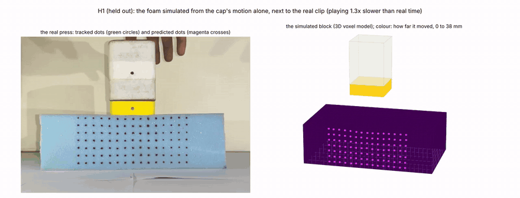
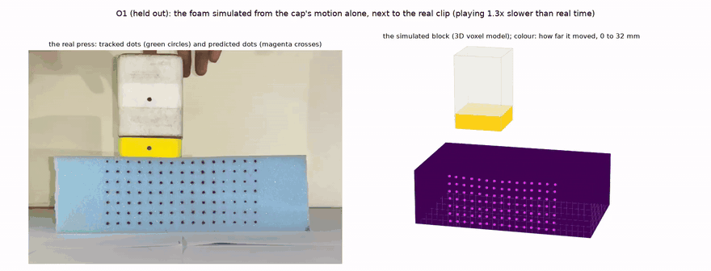
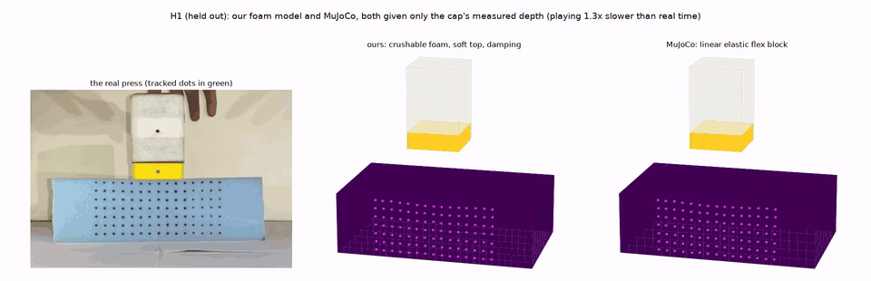
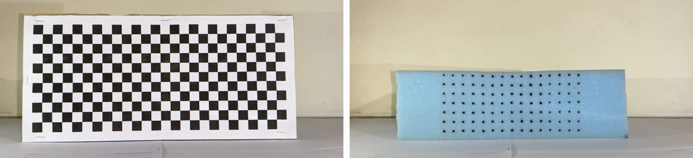

# press2sim

**Learning a foam block's stiffness and damping from video, then predicting presses it has never seen.**

A foam block with a painted grid of 105 dots is pressed by hand with a bottle and filmed in iPhone slow
motion. press2sim tracks the dots to about 0.015 mm and fits a 3D finite-element model of the block:
crushable foam in space, quasi-linear viscoelasticity in time. Given only the bottle's depth over time,
the fitted model then predicts every dot of a press it was never fitted on.



*H1, a press the model never saw. Left: the real clip, with the tracked dots in green and the predicted
dots in magenta. Right: the simulated block, driven only by the cap's measured depth.*
Full-quality videos: [H1](media/H1_simulation.mp4) · [O1, off-centre](media/O1_simulation.mp4) ·
[predicted dots on the original video](media/H1_model_vs_video.mp4) · [ours against MuJoCo](media/H1_ours_vs_mujoco.mp4)

## Results

| Held-out clip | What it is | Deepest | RMS error | RMS movement | Error / movement |
|---|---|---|---|---|---|
| H1 | a fresh press | 38 mm | 1.17 mm | 6.93 mm | 17% |
| O1 | off-centre, under the 5th dot column | 32 mm | 1.01 mm | 5.21 mm | 19% |
| F1 | a fingertip instead of the bottle | about 29 mm | 0.31 mm | 0.92 mm | 34% |

The error is the RMS over all 105 dots and every frame from contact to the end of the clip. On the 11
training presses it is 16–46% of the movement, and 16–20% on the deep ones.



*O1, pressed 30 mm left of the centre and also never used for fitting: the same model, with the cap where
it was.*

- **Stiffness.** E = 178 kPa at small strain. The cells start to buckle at 7% strain (a 12.5 kPa plateau)
  and the crushed cells touch from 55%. E is the least certain number: each dead weight alone gives
  98–183 kPa.
- **Damping.** 12% of the stiffness relaxes with a 0.34 s time constant, plus a 1.2 ms dashpot. It barely
  shows in the dots: switching it off changes the errors by less than 0.01 mm.
- **MuJoCo baseline.** The same block in MuJoCo 4.0, scored the same way, has 1.1–2.4 times our error.
  A finer grid, MuJoCo's plasticity and its inversion-proof material do not close the gap
  ([details](docs/mujoco.md)).



*The same held-out press in our model (middle) and in MuJoCo (right), both given only the cap's measured
depth. MuJoCo's elements collapse under the cap and stay dented after the lift.*

## Check it yourself

Clone the repository, then (Python 3.10 or newer):

```bash
cd press2sim
python -m venv .venv
source .venv/bin/activate          # Windows: .venv\Scripts\activate
pip install -r requirements.txt
python -m pytest -q tests          # 12 pass, 1 slow test is skipped
```

| Notebook | What it does | Needs | Time |
|---|---|---|---|
| [`02_check_results`](notebooks/02_check_results.ipynb) | Recomputes the held-out errors from the saved arrays, predicts H1 again from its cap depth alone, and shows where the error sits, what damping does, how uncertain E is and the MuJoCo comparison | nothing beyond this repo | about 1 minute |
| [`01_reproduce`](notebooks/01_reproduce.ipynb) | Runs everything from the raw clips (frame timing, calibration, tracking, model, videos) and compares your numbers with `results/` | the 22 clips, 1.8 GB | about 1 hour on 2 cores |

**Raw clips:** [Google Drive folder](https://drive.google.com/drive/folders/1NeI0AOQUbnOajynEOH5SJd4AMVeiI9OX?usp=sharing)
(22 clips, 1.8 GB). They are 1080p HEVC at 240 fps nominal, with the audio removed and the video
untouched: every frame and timestamp is identical to what the camera recorded. Put them in `raw/`.
Every step is also a command, listed in [docs/pipeline.md](docs/pipeline.md).

## How it works

1. **Capture.** One iPhone on a tripod films the block's dotted front face (15 × 7 dots) in slow motion.
   Slow motion drops frames, so every frame keeps its own timestamp.
2. **Calibration.** A printed checkerboard ([printable PDF](docs/checkerboard_260x110mm.pdf), 26 × 11
   squares of 10 mm) stands flat against the dotted face in the first clip, and its 250 inner corners map
   pixels to millimetres. Rulers on the foam then correct heights on the face by 4.9%, because the card
   sat slightly off the face's plane.

   

   *Left: the printed checkerboard standing flat against the dotted face (calibration clip C1). Right: the
   same camera view without the card. The board's corners give the pixel-to-millimetre map for the dots.*
3. **Tracking.** Each dot is a contrast-weighted centroid matched to the grid. Two dots on the bottle give
   the cap's depth and tilt. On synthetic clips with known truth, dot positions are accurate to 0.015 mm.
4. **Model.** A hexahedral finite-element grid (a voxel grid) of the whole 234 × 140 × 73 mm block. The
   foam is crushable (linear, a buckling plateau, densification), the cut top is softer, the support
   gives a little, and time enters through Fung's quasi-linear viscoelasticity plus a dashpot. The dots
   ride on the face nodes.
5. **Fitting**, in three separate steps, so that each kind of observation sets only what it can: the
   shape from pressing frames, the damping from the release and recovery, the stiffness from dead
   weights, the only clips with a known force. H1, O1 and F1 are never used.

Details: [docs/pipeline.md](docs/pipeline.md) (clips to tracked dots), [docs/model.md](docs/model.md)
(the model, the fit and every press's error), [docs/mujoco.md](docs/mujoco.md) (the baseline).

## Assumptions

- The foam is homogeneous and isotropic, so one set of parameters describes the whole block.
- Only motion in the face's plane is measured, so the model is checked in that plane alone.
- The bottle's cap is a flat, rigid 60 × 60 mm square, flush with the face, and its depth fully describes
  the load. The fingertip in F1 is an 8 mm-radius disc whose size and position were guessed.
- Small-strain elements with a secant crushable-foam law are used up to 65% compression.

## Limitations

- **The stiffness is uncertain.** There was no force sensor; the dead weights give E between 98 and 183
  kPa depending on the load, likely because the pad settles onto the block's uneven top first. The dot
  motion in a press does not depend on E, but predicted forces carry about ±40%.
- **Damping cannot be pinned down from these clips.** The foam kept up with the cap even when it was
  lifted at 1.2 m/s, so only the slow 12% relaxation is visible.
- **Most of the error is at the deepest frames**, in the top row beside the cap and in the bottom row.
  Sideways motion of the top row is underpredicted: 6–7 mm against 9–12 mm measured in H1.
- **The camera setup is good, not perfect.** The checkerboard's hold-out error is 0.32 mm, the two
  checkerboard clips differ by 0.43 mm, and static features show 0.5–2 px of apparent camera shift within
  most clips. Each clip is measured from its own rest frame, and the tracks are not corrected for that
  shift.
- **One block, one indenter, presses by hand.** The fitted numbers describe this foam in this setup.

## What's in the repository

```
press2sim/     the package: video timing, calibration, dots and tracking, the 3D model, fitting, reports, MuJoCo baseline
notebooks/     01_reproduce (raw clips to every result) and 02_check_results (checks the results in a minute)
results/       the reference run behind every number in this README
media/         the demo GIF and videos
docs/          details on the pipeline, the model and the MuJoCo comparison
scripts/       synthetic test clips with known truth, and the MuJoCo follow-up checks
tests/         unit tests and checks on real frames
trials.csv     which clip is which, with the dead-weight readings
```

## Credits

Code and tools this project uses:

- [NumPy](https://numpy.org) and [SciPy](https://scipy.org): arrays, sparse matrices, image filters, the finite-element assembly and solves.
- [OpenCV](https://opencv.org): checkerboard corners (`findChessboardCornersSB`), the homography, and the optical flow behind the camera-still check.
- [PyAV](https://pyav.org) on [FFmpeg](https://ffmpeg.org): decoding the iPhone clips with each frame's own timestamp. FFmpeg also encodes the output videos when it is installed.
- [matplotlib](https://matplotlib.org): every plot and the drawn frames of the videos.
- [PyAMG](https://github.com/pyamg/pyamg): the algebraic multigrid preconditioner that makes the 3D block solves about ten times faster.
- [MuJoCo](https://mujoco.org) 4.0 (Google DeepMind): the baseline comparison, including its experimental Stable Neo-Hookean material.
- [pandas](https://pandas.pydata.org) and [Jupyter](https://jupyter.org): the notebooks.
- [pytest](https://pytest.org): the tests.
- Optional: [CoTracker3](https://co-tracker.github.io) (Meta AI, CC-BY-NC) for the tracking cross-check, loaded through PyTorch Hub.

The physical model follows standard references: the linear, plateau and densification regimes of crushable
foam (Gibson and Ashby, *Cellular Solids*) and Fung's quasi-linear viscoelasticity (Fung, *Biomechanics*).
