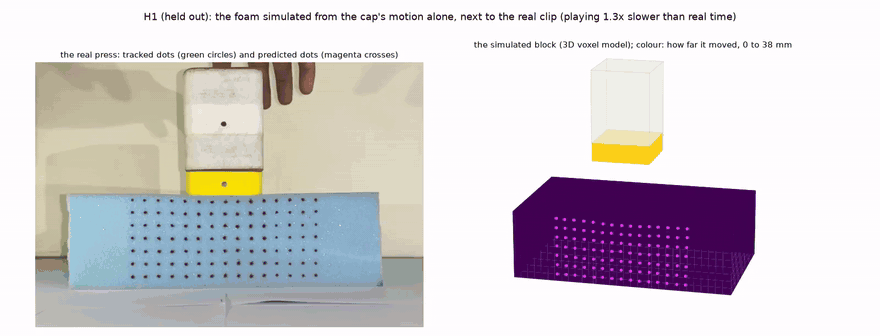
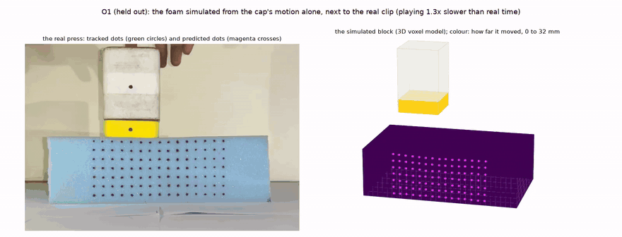
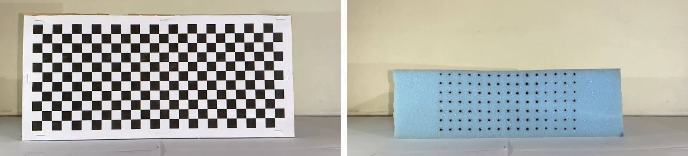

# press2sim

**Learning a foam block's stiffness and damping from video, then predicting presses it has never seen.**

A foam block with a painted grid of 105 dots is pressed by hand with a bottle and filmed in iPhone slow
motion. press2sim tracks how far each dot moves and fits a 3D finite-element model of the block:
crushable foam in space, quasi-linear viscoelasticity in time. Given only the bottle's depth over time,
the fitted model then predicts every dot of a press it was never fitted on.



*H1, a press the model never saw. Left: the real clip, with the tracked dots in green and the predicted
dots in magenta. Right: the simulated block, driven only by the cap's measured depth.*
Full-quality videos: [H1](media/H1_simulation.mp4) · [O1, off-centre](media/O1_simulation.mp4) ·
[predicted dots on the original video](media/H1_model_vs_video.mp4) · [ours against MuJoCo](media/H1_ours_vs_mujoco.mp4)

**Try it in your browser:** [put a weight on the fitted block](https://abeey04.github.io/press2sim/explore.html)
and drag it anywhere on the top.

## Results

| Held-out clip | What it is | Deepest | RMS error | RMS movement | Error / movement |
|---|---|---|---|---|---|
| H1 | a fresh press | 38 mm | 1.13 mm | 6.92 mm | 16% |
| O1 | off-centre, under the 5th dot column | 32 mm | 1.01 mm | 5.21 mm | 19% |
| F1 | a fingertip instead of the bottle | about 29 mm | 0.31 mm | 0.92 mm | 34% |

The error is the RMS over all 105 dots and every frame from contact to the end of the clip. F1 has no
bottle to give its depth, so the depth is read off the one dot under the fingertip through the model,
and that dot is left out of the score.



*O1, pressed 30 mm left of the centre and also never used for fitting.*

- **Stiffness:** E = 185 kPa at small strain, with a 12.9 kPa plateau once the cells buckle at 7% strain.
  E is the least certain number: each dead weight alone gives 101–190 kPa (see Limitations).
- **Damping:** 16% of the stiffness relaxes with a 0.56 s time constant. It is fitted to the dent the cap
  leaves behind after release. On the held-out presses that dent is predicted to 0.17 mm (H1) and
  0.22 mm (O1), against 0.76 and 0.67 mm with no damping.
- **MuJoCo baseline:** the same block in MuJoCo 4.0, scored the same way, has 1.1–2.4 times our error
  ([details](docs/mujoco.md)).

## Check it yourself

Clone the repository, then (Python 3.12 or newer; `requirements.txt` pins the versions behind `results/`):

```bash
cd press2sim
python -m venv .venv
source .venv/bin/activate          # Windows: .venv\Scripts\activate
pip install -r requirements.txt
python -m pytest -q tests          # 18 pass, 1 slow test is skipped
```

| Notebook | What it does | Needs | Time |
|---|---|---|---|
| [`02_check_results`](notebooks/02_check_results.ipynb) | Recomputes the held-out errors from the saved arrays and predicts H1 again from its cap depth alone | nothing beyond this repo | about 1 minute |
| [`01_reproduce`](notebooks/01_reproduce.ipynb) | Runs everything from the raw clips and compares your numbers with `results/` | the 22 clips, 1.8 GB | about 1 hour on 2 cores |
| [`03_walkthrough`](notebooks/03_walkthrough.ipynb) | The method one step at a time, with a CoTracker3 cross-check of the tracker | the clips, PyTorch with a GPU | about 40 minutes the first time |

**Raw clips:** [Google Drive folder](https://drive.google.com/drive/folders/1NeI0AOQUbnOajynEOH5SJd4AMVeiI9OX?usp=sharing)
(22 clips, 1.8 GB; the audio is removed and the video is untouched). Put them in `raw/`. Every step is
also a command, listed in [docs/pipeline.md](docs/pipeline.md).

`results/` holds the reference run behind every number here, and `trials.csv` says which clip is which,
with the dead-weight readings.

## How it works

1. **Capture:** one iPhone on a tripod films the block's dotted front face (15 × 7 dots) in slow motion.
   Slow motion drops frames, so every frame keeps its own timestamp.
2. **Calibration:** a printed checkerboard ([printable PDF](docs/checkerboard_260x110mm.pdf)) stands flat
   against the dotted face in the first clip and maps pixels to millimetres. Rulers on the foam then
   correct heights on the face by 4.9%, because the card sat slightly off the face's plane.

   
3. **Tracking:** each dot is a contrast-weighted centroid matched to the grid. Two dots on the bottle give
   the cap's depth and tilt. On synthetic clips with known truth, each dot's movement is accurate to
   0.03 mm and the cap's depth to 0.3 mm.
4. **Model:** a hexahedral finite-element grid of the whole 234 × 140 × 73 mm block. The foam is crushable
   (linear, a buckling plateau, densification), a thin top layer is much softer, and time enters through
   Fung's quasi-linear viscoelasticity.
5. **Fitting**, in three separate steps: the
   shape from pressing frames, the damping from the dent the cap leaves behind, the stiffness from dead
   weights, the only clips with a known force. H1, O1 and F1 are never used. The shape search starts
   from a hand-set start ([docs/model.md](docs/model.md) says why).

Details: [docs/pipeline.md](docs/pipeline.md) (clips to tracked dots), [docs/model.md](docs/model.md)
(the model, the fit and every press's error), [docs/mujoco.md](docs/mujoco.md) (the baseline).

## Assumptions

- The foam is homogeneous and isotropic, so one set of parameters describes the whole block.
- Only motion in the face's plane is measured, so the model is checked in that plane alone.
- The bottle's cap is a flat, rigid 60 × 60 mm square, flush with the face, and its depth fully describes
  the load. The fingertip in F1 is an 8 mm-radius disc whose size and position were guessed.
- Small-strain elements are used far past small strains: the presses reach 65% of the block's height.

## Limitations

- **The stiffness is uncertain by a factor of 2 to 3.** There was no force sensor. E comes from four dead
  weights through parts of the model the dots cannot pin down: 185 kPa as fitted, and 71 to 148 kPa
  under other assumptions. The dot motion in a press does not depend on E.
- **The soft top layer is a stand-in, not a measured layer.** About 5 mm of the cap's travel never reaches
  the dots, and the model absorbs it in a 3 mm top layer 18 times softer than the rest. A rounded cap rim
  or a few millimetres of bias in the cap's depth would look the same.
- **Damping rests on one small signal.** While the cap presses, its depth sets the dots, so damping shows
  only in the dent left after release: under a millimetre, at six dots. Over all 105 dots around the
  lift, the fitted damping scores barely better than none (0.717 against 0.723 mm).
- **Most of the error is at the deepest frames**, in the top row beside the cap, where sideways motion
  is underpredicted.
- **The camera setup adds small errors.** The checkerboard's hold-out error is 0.32 mm, the two
  checkerboard clips differ by 0.43 mm, and the tracks are not corrected for the small camera shift
  seen within most clips.
- **One block, one indenter, presses by hand:** the fitted numbers describe this foam in this setup.

The numbers behind each point are in [docs/model.md](docs/model.md) and
[docs/pipeline.md](docs/pipeline.md).

## Credits

- [NumPy](https://numpy.org), [SciPy](https://scipy.org), [OpenCV](https://opencv.org),
  [PyAV](https://pyav.org) on [FFmpeg](https://ffmpeg.org), [matplotlib](https://matplotlib.org),
  [pandas](https://pandas.pydata.org), [Jupyter](https://jupyter.org) and [pytest](https://pytest.org).
- [PyAMG](https://github.com/pyamg/pyamg): the multigrid preconditioner for the 3D solves.
- [MuJoCo](https://mujoco.org) 4.0 (Google DeepMind): the baseline comparison.
- [three.js](https://threejs.org) r128: the interactive page.
- [CoTracker3](https://co-tracker.github.io) (Meta AI, CC-BY-NC), through [PyTorch](https://pytorch.org)
  Hub: the optional tracking cross-check. The README's numbers do not use it.

The physical model follows Gibson and Ashby, *Cellular Solids* (crushable foam) and Fung, *Biomechanics*
(quasi-linear viscoelasticity).
