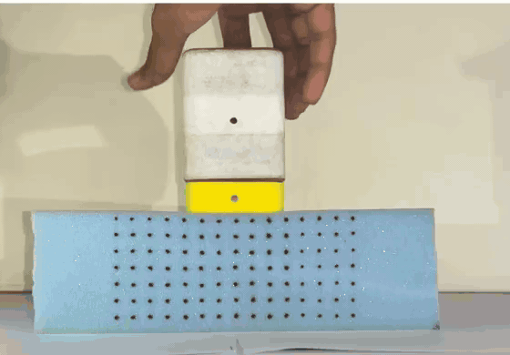

# The model: what it is, how it was fitted, what it predicts

`python -m press2sim model --trials trials.csv --raw raw` fits the model on the training clips,
predicts every press (training and held out), and writes to `out/model/`:

- `params.json`: the fitted parameters, effective stiffness and damping, every fit's history
- `predictions.csv`: the error for every clip
- `H1_*.png`, `O1_*.png`, `F1_*.png`: model against measurement for the held-out clips
- `H1_model_vs_video.mp4`, `O1_model_vs_video.mp4`: the prediction drawn on the original video
- `H1_3d.png`: the model block at the deepest point
- `H1_simulation.mp4`, `O1_simulation.mp4`: the simulated 3D block next to the real clip, both driven by the
  same cap motion (made by `python -m press2sim simulate --trials trials.csv --raw raw`)
- `pred_<code>.npz`: the predicted dot movement for every press

Add `--keep-shape` to reuse the shape from `out/model/start.json` and refit only the damping and stiffness (a minute instead of 20).

The reference run's copies are in `results/model/` and `results/predictions/`; every number below comes from them.

## What it is

A 3D model of the block, driven only by what pushes on it.

- **Space:** a voxel grid of the whole block. The 234 × 139.5 × 73 mm block is cut into
  hexahedral elements (7.5 mm near the dotted face and the top, coarser at the back). Each element
  is a crushable foam: linear up to a strain ε_y, then a soft plateau where the cells buckle (slope
  h·E), then stiffening again once the crushed cells touch (from ε_d). The top 3 mm, where the
  block was cut and its cells are broken, is softer. The cap is a flat rigid
  60 × 60 mm square pushed into the top, its front edge level with the dotted face. The block stands
  on a slightly compliant support. The dead-weight clips showed this clearly: under the 2.4 kg
  weight the bottom row of dots sank about half as far as the top row, where a block on a rigid
  table would barely move at the bottom. The dots are carried by the grid like particles in a particle-voxel scheme:
  each one moves with the face nodes around it.
- **Time:** quasi-linear viscoelasticity (Fung), plus a dashpot. The force on the foam is
  `F(t) = E [g∞ R(q) + h + τ_v dR(q)/dt]`, with `dh/dt = g dR(q)/dt − h/τ` and `g∞ = 1 − g`. R(q)
  is the grid's elastic force at indentation q. The relaxing part h makes the force fall while the
  cap holds still; the dashpot τ_v limits how fast the foam can spring back. While the cap touches
  the foam, q is the cap's measured depth. When the foam would have to pull on the cap to keep up
  (F < 0), the two part and q follows F = 0: the foam rises on its own. Under a dead weight,
  F = m g instead.

**Effective stiffness** is E (the small-strain Young's modulus) together with the plateau; the
force on the cap at any depth follows from the grid. **Effective damping** is the relaxing fraction g
with its time constant τ (a viscosity of g·E·τ), and the dashpot τ_v.

## How it was fitted, in three separate steps

The clips are split: training presses fit the model; H1 (a fresh press), O1 (off-centre, under the
5th column) and F1 (a fingertip) are never used for fitting.

1. **Shape** (ε_y, h, ε_d, Poisson's ratio ν, the soft top layer, the cap's position relative to
   the face): 16 frames from each training press, spread over the depths it went through while
   the cap was pushing. With the cap's depth imposed, quasi-linear viscoelasticity leaves the
   deformation's shape purely elastic, so these can be fitted before the damping. A coordinate
   search over the parameters, about 30 grid solves. The support comes from the pattern of the
   dead-weight clips (how far the bottom row sinks compared with the top row), before and after.
2. **Damping** (g, τ, τ_v): the frames from just before the cap lifts until 2.5 s later, where the
   foam either keeps up with the rising cap or lets go of it and comes back on its own.
3. **Stiffness E**: the dead-weight clips K1–K4, where the force is known (m g). Hand presses can't
   give E, because the hand's force was never measured. In return the model *predicts* the force the
   hand applied in every press.

## The demo

For a held-out press the model gets the cap's measured depth over time (from the two bottle dots)
and nothing else. It predicts all 105 dots at every frame, which are then compared with the tracked
dots.

*H1, played at about 0.6 times real speed: tracked dots in green, the model's prediction in magenta.*

## Fitted parameters

| What | Value | From |
|---|---|---|
| Young's modulus at small strain, E | 178 kPa | dead weights K1–K4 |
| Cells start to buckle at strain ε_y | 0.070 (plateau stress 12.5 kPa) | presses |
| Plateau slope h | 0.070 × E | presses |
| Crushed cells touch from strain ε_d | 0.55 | presses |
| Poisson's ratio ν | 0.00 | presses |
| Softer cut top surface | 3.0 mm at 0.055 × E | presses |
| Cap's front edge relative to the dotted face | flush (0 mm) | presses |
| Support under the block | 0.0296 × E per mm | dead weights |
| Damping: fraction of the stiffness that relaxes, and how fast | 0.12, τ = 0.34 s (viscosity 7.3 kPa·s) | release and recovery of the presses |
| Damping: dashpot in parallel (limits how fast the foam springs back) | τ_v = 1.2 ms | release and recovery of the presses |

Effective stiffness of the block under the cap (fast = before any relaxation, long-term = after it):

| Depth | Force, fast | Force, long-term | Stiffness, fast | Stiffness, long-term |
|---|---|---|---|---|
| 5 mm | 31.0 N | 27.3 N | 10.85 N/mm | 9.54 N/mm |
| 10 mm | 69.2 N | 60.9 N | 5.51 N/mm | 4.85 N/mm |
| 20 mm | 107.4 N | 94.4 N | 3.93 N/mm | 3.46 N/mm |
| 30 mm | 154.1 N | 135.6 N | 4.76 N/mm | 4.19 N/mm |

Under the full pad the block's stiffness is 37 N/mm.

## Predictions

RMS error of all 105 dots over every frame from just before contact to the end of the clip, against the RMS movement of the dots over the same frames. The model gets only the cap's depth over time.

| Clip | Set | Deepest | RMS error | RMS movement | Error / movement | At the deepest frame | Top / middle / bottom row | No damping |
|---|---|---|---|---|---|---|---|---|
| T01 | training | 23.9 mm | 0.56 mm | 1.86 mm | 30% | 1.20 mm | 0.73 / 0.61 / 0.29 mm | 0.56 mm |
| T02 | training | 25.6 mm | 0.82 mm | 2.58 mm | 32% | 1.34 mm | 0.94 / 0.99 / 0.42 mm | 0.81 mm |
| T03 | training | 20.4 mm | 0.96 mm | 2.10 mm | 46% | 1.55 mm | 1.06 / 1.10 / 0.55 mm | 0.96 mm |
| T04 | training | 32.6 mm | 0.80 mm | 4.09 mm | 20% | 1.29 mm | 1.18 / 0.73 / 0.33 mm | 0.80 mm |
| T05 | training | 31.9 mm | 0.87 mm | 4.44 mm | 20% | 1.23 mm | 1.24 / 0.82 / 0.37 mm | 0.88 mm |
| T06 | training | 34.0 mm | 0.88 mm | 5.06 mm | 17% | 1.34 mm | 1.32 / 0.73 / 0.33 mm | 0.89 mm |
| T07 | training | 45.1 mm | 1.47 mm | 8.34 mm | 18% | 2.31 mm | 2.06 / 1.12 / 0.78 mm | 1.47 mm |
| T08 | training | 45.6 mm | 1.62 mm | 9.18 mm | 18% | 2.28 mm | 2.26 / 1.28 / 0.81 mm | 1.62 mm |
| T09 | training | 47.6 mm | 1.65 mm | 8.98 mm | 18% | 2.65 mm | 2.27 / 1.33 / 0.81 mm | 1.65 mm |
| R1 | training | 35.0 mm | 0.84 mm | 5.40 mm | 16% | 1.22 mm | 1.29 / 0.65 / 0.44 mm | 0.84 mm |
| R2 | training | 50.0 mm | 1.97 mm | 10.54 mm | 19% | 2.89 mm | 2.78 / 1.60 / 0.95 mm | 1.97 mm |
| H1 | held out | 38.4 mm | 1.17 mm | 6.93 mm | 17% | 1.57 mm | 1.72 / 0.83 / 0.61 mm | 1.17 mm |
| O1 | held out | 32.4 mm | 1.01 mm | 5.21 mm | 19% | 1.56 mm | 1.64 / 0.79 / 0.59 mm | 1.01 mm |
| F1 | held out: fingertip, driven by the one dot under it | 28.9 mm (inferred) | 0.31 mm | 0.92 mm | 34% | 0.58 mm | 0.39 / 0.26 / 0.12 mm | 0.31 mm |

How to read this:

- **The shape carries the prediction.** Deep presses are predicted to within 16–20% of how far the
  dots moved, and the held-out presses no worse than the training ones: H1 (a fresh press, 38 mm)
  17%, O1 (off-centre, a different FE run with the cap 30 mm to the left) 19%. The shallow presses
  T01–T03 have larger relative errors because the dots moved less, not because the errors are
  larger. The crushable foam matters: the deformation spreads deep at first, concentrates near the
  cap once the cells start buckling, and spreads deep again as the crushed layer stiffens. A
  linear elastic block spreads it the same way at every depth.
- **Damping barely shows in the dots.** The foam kept up with the cap even when the cap was lifted
  at over a metre per second, so the dashpot came out at about a millisecond, and the no-damping
  column is the same to 0.01 mm. What remains is a slow part: 12% of the stiffness relaxes with
  τ ≈ 0.34 s. It shows as the force dropping while the cap holds still, and as the last
  millimetre or two of dent fading over about a second after the cap leaves.
- **E is the least certain number.** Fitted to each weight alone it comes out as K1 98, K2 140, K3 165, K4 183 kPa: the
  heavier the weight, the stiffer the block looks. The block's top dips about 2 mm in the middle,
  so the rigid pad first settles before it bears evenly. The joint fit (178 kPa) is dominated by the
  heavier weights. The dots' movement in a press doesn't depend on E at all; only the predicted
  forces do, so treat them as ±40%.
- **The fingertip (F1)** is a rough stand-in: an 8 mm-radius disc whose centre is 9 mm behind the
  face, both guessed rather than measured, driven by the one dot under it. It still predicts the
  other 104 dots to 0.31 mm (34% of their movement).

## Limits

- Small-strain elements at up to 65% compression. Most of the remaining error is at the deepest
  frames of the deepest presses: the top row beside the cap, and the bottom row. In T09 the bottom
  row sinks about 6 mm along the whole length of the block; the model gets that under the cap but
  only about half of it at the ends.
- The face's movement towards or away from the camera is invisible, so the model is only checked
  in the face's plane.
- Sideways movement of the top row towards the cap is underpredicted: in H1 about 6–7 mm against
  9–12 mm measured.
- One block, one indenter shape, presses by hand: the fitted numbers describe this foam in this
  setup.
